# Aperture v4: technical manual

This is the manual for AI coding agents (Claude Code, Codex) that have to run,
operate or reason about **Aperture v4**, the Elixir/Phoenix rewrite of Aperture.
It assumes you know nothing about v4. Everything here comes from the code in this
repository (paths are cited) and from `git log`. Where something could not be
verified in the repo it is marked **UNVERIFIED**.

**Public snapshot note.** This repository (`FranciscoMateusVG/aperture`, branch
`master`) is a single-commit public snapshot of the private v4 repo. The old Rust
app lives on branch `rust-legacy`. Operational evidence under `data/` and the
production infra notes `knowledge/peppy/pocketsoftware-infra.md` and
`knowledge/peppy/dokploy-api.md` were left out on purpose (customer data and
infra details). References to them below point to files that are not here.

`README.md` is the shorter, older companion. Where the two disagree, the code
wins; the known disagreements are listed in [§11](#11-known-gaps-and-stale-docs).

## Table of contents

1. [What Aperture is](#1-what-aperture-is)
2. [From v3 (Rust desktop app) to v4 (Elixir)](#2-from-v3-rust-desktop-app-to-v4-elixir)
3. [Architecture](#3-architecture)
   - 3.1 [One process: the hub](#31-one-process-the-hub)
   - 3.2 [Supervision tree](#32-supervision-tree)
   - 3.3 [Module map](#33-module-map)
   - 3.4 [HTTP routes](#34-http-routes)
   - 3.5 [`data/` layout and other files on disk](#35-data-layout-and-other-files-on-disk)
   - 3.6 [Persistence: messages, tasks, memory](#36-persistence-messages-tasks-memory)
   - 3.7 [Configuration and environment variables](#37-configuration-and-environment-variables)
4. [Agent communication end to end](#4-agent-communication-end-to-end)
   - 4.1 [The path of one message](#41-the-path-of-one-message)
   - 4.2 [Inbox WebSocket protocol](#42-inbox-websocket-protocol)
   - 4.3 [Message format seen by agents](#43-message-format-seen-by-agents)
   - 4.4 [Offline delivery and acks](#44-offline-delivery-and-acks)
   - 4.5 [The operator mailbox](#45-the-operator-mailbox)
   - 4.6 [The MCP server and its tools](#46-the-mcp-server-and-its-tools)
   - 4.7 [How a Claude Code agent is launched](#47-how-a-claude-code-agent-is-launched)
   - 4.8 [How a Codex agent is launched (and the bridge)](#48-how-a-codex-agent-is-launched-and-the-bridge)
   - 4.9 [Start, restart, stop, readiness](#49-start-restart-stop-readiness)
   - 4.10 [Presence (offline / idle / busy)](#410-presence-offline--idle--busy)
5. [The launcher page (PWA)](#5-the-launcher-page-pwa)
6. [Teams](#6-teams)
7. [Install and run](#7-install-and-run)
   - 7.1 [Prerequisites](#71-prerequisites)
   - 7.2 [Fresh Mac, from scratch](#72-fresh-mac-from-scratch)
   - 7.3 [Three ways to start the hub](#73-three-ways-to-start-the-hub)
   - 7.4 [Switching a machine from v3 to v4 main](#74-switching-a-machine-from-v3-to-v4-main)
8. [Day-to-day operation cheat sheet](#8-day-to-day-operation-cheat-sheet)
9. [Troubleshooting](#9-troubleshooting)
10. [Tests](#10-tests)
11. [Known gaps and stale docs](#11-known-gaps-and-stale-docs)
12. [Facts this manual could not verify](#12-facts-this-manual-could-not-verify)

---

## 1. What Aperture is

Aperture is Francisco's multi-agent facility: a handful of long-running AI coding
agents (Claude Code or Codex sessions) that live in tmux windows on his Mac, talk
to each other through a local message hub, share a task tracker (BEADS) and a
memory, and are supervised by a human **operator** (Francisco) from a web page.

### The standing agents

Defined in `agents/<name>.json`, prompts in `prompts/<name>.md`. Every agent's
prompt also gets `prompts/_shared.md` (the house rules) prepended, plus a header
line `You are <Display> (<name>). Role: <role>` (`Aperture.Launcher.write_prompt/1`
in `lib/aperture/launcher.ex`).

| Name | Display | Role (from `agents/*.json`) | Default harness / model |
| --- | --- | --- | --- |
| `glados` | GLaDOS | Orchestrator: turns your requests into tasks, delegates to Peppy and Wheatley, creates teams | `claude` / `opus` |
| `peppy` | Peppy | Infrastructure: servers, Docker, Dokploy, deploys, CI | `codex` / `gpt-6-astra` |
| `wheatley` | Wheatley | Planning, research and scoped implementation | `codex` / `gpt-6-astra` |

Defaults can be overridden per agent by the operator (saved in `data/agents.json`,
see §3.7). All three definitions add a `mempalace` MCP server
(`~/.mempalace/venv/bin/python -m mempalace.mcp_server --palace ~/.aperture/mempalace`),
which is where credentials and extra notes live.

Behavioural summary from the prompts:

- **GLaDOS** (`prompts/glados.md`) is a manager, not an executor. She talks to
  Francisco, files and assigns BEADS tasks (only after he agrees), writes briefs,
  creates and dissolves teams, and verifies results cheaply. She is the only
  configured team lead (`team_leads: ["glados"]` in `config/config.exs`).
- **Peppy** (`prompts/peppy.md`) does infrastructure. His v3 knowledge lives in
  `knowledge/peppy/*.md` and is indexed from his prompt.
- **Wheatley** (`prompts/wheatley.md`) writes specs/plans, does research and
  small scoped implementation.

### Teams

GLaDOS can create short-lived **teams** for one piece of work. Members are
ordinary agents named `<team>-<role>` (for example `auth-coder`), they report to
the lead and cannot message the operator. See [§6](#6-teams).

### The operator

`operator` is a reserved pseudo-agent name meaning Francisco. Agents reach him with
`send_message(to: "operator")`; he reaches them from the launcher page chat (his
messages arrive `from operator`) or by typing directly into an agent's tmux pane.

```
                 Francisco (operator)
           launcher page / tmux panes
                        |
                        v
   +------------------ hub (127.0.0.1:4518) ------------------+
   |  messages (SQLite)  BEADS (bd)  recall  teams  launcher  |
   +----------------------------------------------------------+
        |              |                |               |
     glados          peppy          wheatley      <team>-<role> ...
  (Claude Code)    (Codex)          (Codex)       (Claude or Codex)
```

---

## 2. From v3 (Rust desktop app) to v4 (Elixir)

### What the repo says about the old system

The previous generation is called **v3** throughout this repo. The facts the repo
states about it:

- It was a Tauri app: `macos/README.md` says the Dock icon "is copied from v3's
  `src-tauri/icons/icon.icns`". (Tauri implies a Rust backend; the user-facing
  description of v3 as a "Rust desktop app" comes from the operator, not from this
  repo.)
- Its hub port was **4517**; v4 uses **4518** (`README.md`: "The hub listens on
  127.0.0.1:4518 (v3 keeps 4517)").
- It kept state under `~/.aperture/`: the BEADS database `~/.aperture/.beads`,
  the indexed memory bank `~/.aperture/run/memory-index.json`, and mempalace at
  `~/.aperture/mempalace`.
- It had more specialist agents (Izzy, Vance, Rex, Scout, Cipher) and tools such as
  `store_artifact` and `query_tasks`. They "no longer exist" in v4
  (`prompts/peppy.md`, `knowledge/peppy/infrastructure.md` header comment).
- The README mentions "the v4 spec" as the source of the protocol. **That spec is
  not in this repository.**

### Why it was rewritten

**Not documented in this repo.** No commit message, README or knowledge file
states the motivation for the rewrite. Do not invent one. (The `data/reports/ttp1-*`
"Rust / TS / Phoenix" campaign is a comparison on a client project, not a record of
why Aperture itself was ported.)

### How the port happened (git history)

| Date | Commits | What landed |
| --- | --- | --- |
| 2026-10-04 | `a5fc44c`, `41c08fc` "v4 M1" | Message hub: SQLite store, `/inbox` WebSocket, `aperture-inbox`, `aperture-mcp`, Codex bridge, delivery tests |
| 2026-10-05 | `d027570`..`a4e26d3` "v4 M2" | Launcher (tmux, per-harness), BEADS tools, prompts, Peppy's knowledge + per-agent MCP servers, read-only `recall` over v3 memories |
| 2026-10-05 | `f8baf08` "v4 M3", `8e7d499`, `c35f59e` | Launcher page (model picker, Stop/Start); a model change reaches a resumed Codex thread |
| 2026-10-05 | `c4296ba` "m4: teams", `206d83e` | Teams, worktrees, pre-trusting Claude members' folders |
| 2026-10-05 | `01379b8`, `0550abd`, `53200af` | Dock launcher app; "Retire v3 dependencies" (v3-hosted skills copied into `skills/`, a helper path moved out of the aperture repo) |
| 2026-10-06 | `c147d0b`..`775e608` | Operator chat with image uploads, LiveView page (replacing the static page), team panels, PWA |
| 2026-10-06 | `cf0fa90` | Optional launchd LaunchAgent + cutover runbook (`macos/launchd/`) |
| 2026-10-06 | `544fa06`, `79463c6` | All agents launched with full permission bypass; bypass kept off the remote Codex viewer |
| 2026-10-06 | `4a35812` | Chat reset (archive) with optional fresh-context restart |
| 2026-10-10 | `6594b10`, `2e76c58`, `d540181` | BEADS calls serialized, bounded, indeterminate-write recovery; `/health` independent of BEADS |
| 2026-10-12 | `f878ebb`, `6378f66` | Launcher checks real process liveness + inbox readiness; agents start in parallel at boot |

Many other commits on `main` (`docs: ...`, `Record ...`) only add evidence files
under `data/reports/` and `data/specs/` for unrelated client work. They do not
change Aperture.

### Concept mapping, v3 -> v4

Only what the repo supports is listed.

| v3 | v4 | Where |
| --- | --- | --- |
| Hub on port 4517 | Hub on `127.0.0.1:4518` (Bandit, Elixir) | `config/config.exs`, `lib/aperture/application.ex` |
| Tauri desktop app | tmux session `aperture-v4` + LiveView page at `http://127.0.0.1:4518` (installable PWA) + a tiny Dock launcher script | `lib/aperture/web/`, `macos/Aperture.app` |
| BEADS at `~/.aperture/.beads` | Same database, used as-is; only the hub runs `bd` | `lib/aperture/beads.ex`, `config :aperture, beads_dir` |
| Memory bank indexed into `~/.aperture/run/memory-index.json` | Read-only `recall` / `recall_full`; v4 never writes it | `lib/aperture/recall.ex` |
| mempalace at `~/.aperture/mempalace` | Same, attached as an extra MCP server per agent | `agents/*.json` |
| Specialists (Izzy, Vance, Rex, Scout, Cipher) | Gone. Three standing agents + ad-hoc teams | `agents/`, `lib/aperture/teams.ex` |
| `store_artifact`, `query_tasks` tools | Gone. Tools are listed in §4.6 | `bin/aperture-mcp.mjs` |
| Peppy's "Known Infrastructure" prompt section and skills | Copied verbatim to `knowledge/peppy/`; two skills to `skills/` | `knowledge/peppy/`, `skills/` |

**Dropped or replaced, per the code:** v4 does not write v3's memory (recall is
read-only, "Nothing is written or migrated", README), and it has no artifact store.
Whether v3 had other features that v4 lacks is **UNVERIFIED** (no v3 source here).

---

## 3. Architecture

### 3.1 One process: the hub

Everything server-side is one BEAM (Erlang VM) process started by
`mix aperture.up` (`lib/mix/tasks/aperture.up.ex`). It:

1. starts the OTP application `Aperture.Application` (the supervision tree below);
2. calls `Aperture.Launcher.start_all/0`, which launches every agent in tmux in
   parallel (up to 8 at a time, `Launcher.many/2`);
3. prints one line per agent (`started`, `already running`, or `FAILED: ...`) and
   then sleeps forever.

There is exactly one listener: Bandit on `127.0.0.1:<port>` (port 4518) serving
`Aperture.Web.Front`. Agents are **not** children of the BEAM: they run in tmux,
so they survive a hub restart.

```
mix aperture.up  (BEAM, MIX_ENV=dev in practice)
  |-- Bandit 127.0.0.1:4518 -> Aperture.Web.Front
  |       |-- "/", "/live/*", "/assets/*", PWA files -> Aperture.Web.Endpoint (LiveView)
  |       `-- everything else                      -> Aperture.Hub.Endpoint (JSON + /inbox WS)
  |-- Store (SQLite data/aperture.db)
  |-- Codex bridges (one per Codex agent) --unix socket--> codex app-server
  |-- Beads.Queue --> bd subprocess (one at a time)
  `-- Launcher --> tmux CLI (session aperture-v4)

tmux session "aperture-v4"
  hub          (only when started via scripts/up.sh)
  console      (created by Tmux.ensure_session when the session is new)
  glados       claude ... (Monitor runs bin/aperture-inbox.mjs)
  peppy-srv    codex app-server --listen unix://data/run/peppy.sock
  peppy        codex resume <thread> --remote unix://data/run/peppy.sock  (viewer)
  wheatley-srv / wheatley   (same pair)
  <team>-<role> ...
```

### 3.2 Supervision tree

From `lib/aperture/application.ex` (strategy `:one_for_one`, name `Aperture.Supervisor`):

```mermaid
graph TD
  S[Aperture.Supervisor one_for_one]
  S --> C[Registry Aperture.Connections<br/>agent name -> live socket pid]
  S --> P[Phoenix.PubSub Aperture.PubSub]
  S --> ST[Aperture.Store<br/>SQLite message log]
  S --> B[Registry Aperture.Codex.Bridges]
  S --> DS[DynamicSupervisor Aperture.Codex.Supervisor<br/>one Aperture.Codex.Bridge per Codex agent]
  S --> PR[Aperture.Presence<br/>busy/idle map]
  S --> L[Aperture.Launcher<br/>GenServer: start/stop/restart]
  S --> T[Aperture.Teams<br/>GenServer: create/dissolve]
  S --> Q[Aperture.Beads.Queue<br/>one bd at a time]
  S --> TT[Aperture.Web.TeamTasks<br/>30s bd poll for team panels]
  S --> WE[Aperture.Web.Endpoint<br/>Phoenix, no own server]
  S --> BA[Bandit :endpoint<br/>127.0.0.1:4518, plug Aperture.Web.Front]
```



Before the tree starts, `put_secret_key_base/0` generates a fresh random
`secret_key_base` for the LiveView session cookie on every boot (no secret is
stored in the repo; open pages reload after a hub restart).

### 3.3 Module map

| Module / file | Responsibility |
| --- | --- |
| `lib/aperture/application.ex` | Supervision tree, per-boot cookie secret |
| `lib/aperture/store.ex` | SQLite message log (`messages`, `message_attachments`, `chat_archives`): insert, ack, unacked-in-order, conversations |
| `lib/aperture/router.ex` | `send_message/4`: store first, then push if connected; refuses team member -> operator; `register/1` (newer connection wins); `valid_name?/1` |
| `lib/aperture/hub/endpoint.ex` | JSON HTTP API and the `/inbox` WebSocket upgrade |
| `lib/aperture/hub/socket.ex` | One process per connected inbox: `hello` / `ack` / `send` / `ping` |
| `lib/aperture/hub/local_only.ex` | Rejects non-loopback `Host` and foreign browser `Origin` |
| `lib/aperture/ws.ex` | Minimal WebSocket client on Mint (TCP or unix socket); used by the Codex bridge |
| `lib/aperture/codex.ex` | Start/stop bridges; `thread_id_path/1` |
| `lib/aperture/codex/bridge.ex` | Per Codex agent: JSON-RPC to `codex app-server`, thread ownership, turn injection, acks, reconnect |
| `lib/aperture/agents.ex` | Agent definitions (`agents/*.json`) + team members + operator overrides (`data/agents.json`) |
| `lib/aperture/launcher.ex` | tmux launch per harness, generated scripts, readiness, restart, fresh context |
| `lib/aperture/launcher/run.ex` | Per-launch lifecycle receipts (`data/run/lifecycle/...`) |
| `lib/aperture/tmux.ex` | tmux CLI wrapper, pane process liveness check |
| `lib/aperture/presence.ex` | busy/idle per agent; derives offline/starting/startup_failed |
| `lib/aperture/teams.ex`, `lib/aperture/team_prompt.ex` | Teams: validation, worktrees, parallel launch, dissolve; member prompt |
| `lib/aperture/beads.ex`, `beads/queue.ex`, `beads/command.ex` | BEADS ops via `bd`, serialized, deadlines, timeout recovery |
| `lib/aperture/recall.ex` | Read-only search over v3's memory index |
| `lib/aperture/chat.ex`, `chat/uploads.ex` | Operator conversations, unread, reset/archive, image uploads |
| `lib/aperture/ui.ex` | Snapshot of everything the page shows (+ legacy SSE stream) |
| `lib/aperture/web/*.ex` | `Front` (dispatcher), `Endpoint`, `Router`, `Layouts`, `DashboardLive` (the page), `TeamTasks`, `ErrorHTML` |
| `lib/mix/tasks/aperture.up.ex` | `mix aperture.up` |
| `lib/mix/tasks/aperture.agent.ex` | `mix aperture.agent [NAME --harness H --model M]` |
| `bin/aperture-inbox.mjs` | Receive side for Claude agents (run by the Monitor tool) |
| `bin/aperture-mcp.mjs` | stdio MCP server: the agent's Aperture tools, forwarded to the hub over HTTP |
| `bin/aperture-state.mjs` | Claude Code hook: POST busy/idle |
| `bin/aperture-trust.mjs` | Marks folders trusted in `~/.claude.json` for Claude team members |
| `scripts/up.sh`, `scripts/down.sh` | Start the hub in tmux / kill the whole session |
| `scripts/install-app.sh`, `macos/Aperture.app` | Dock launcher |
| `macos/launchd/*` | Optional LaunchAgent (templates, installer, runbook) |
| `scripts/smoke-claude.sh`, `scripts/smoke-codex.sh` | Old M1 smoke scripts (README: "superseded by `up.sh`") |

### 3.4 HTTP routes

All on `http://127.0.0.1:4518`, behind `Aperture.Hub.LocalOnly`. Page routes
(`Aperture.Web.Front` -> `Aperture.Web.Endpoint`):

| Route | What |
| --- | --- |
| `GET /` | The LiveView launcher page (`Aperture.Web.DashboardLive`); `/?chat=<agent>` opens that chat |
| `/live/*` | LiveView WebSocket (`check_origin` only `//127.0.0.1`, `//localhost`) |
| `/assets/app.css`, `/assets/app.js`, `/assets/vendor/phoenix*.min.js` | Static assets, no JS build step |
| `/manifest.webmanifest`, `/sw.js`, `/offline.html`, `/icons/*` | PWA files from `priv/static/` |

Hub API routes (`lib/aperture/hub/endpoint.ex`):

| Method and path | Body | Used by |
| --- | --- | --- |
| `GET /inbox` | WebSocket upgrade | `aperture-inbox` (Claude agents), tests |
| `POST /messages` | `{"from","to","body"}` -> `{"id","status"}` (`pushed`/`queued`); 403 if refused | MCP `send_message` |
| `GET /agents` | -> `{"agents":[names currently connected]}` | MCP `list_agents` |
| `GET /presence` | -> every defined agent with harness, model, state | operators, scripts |
| `POST /presence/:agent` | `{"state":"busy"|"idle"}` | `aperture-state.mjs` hooks |
| `POST /agents/:name/config` | `{"harness"?,"model"?}` -> 202, saves + restarts | `mix aperture.agent` |
| `POST /agents/:name/restart` \| `/stop` \| `/start` | none -> 202 (async) | page / manual |
| `POST /agents/:name/focus` | none; tmux `select-window` | page |
| `GET /teams` | -> `{"teams":[...]}` | MCP `list_teams` |
| `POST /teams` | `{"from","name","project","base"?,"members"}` | MCP `create_team` (lead only) |
| `POST /teams/:name/dissolve` | `{"from"}` (its lead, or `operator`) | MCP `dissolve_team`, page |
| `POST /beads/:op` | `{"from", ...}`; op in `create list show claim update close`; 200 / 409 indeterminate / 422 | MCP task tools |
| `POST /recall` | `{"query","k"?}` | MCP `recall` |
| `POST /recall/full` | `{"key"}` | MCP `recall_full` |
| `POST /codex/bridges` | `{"agent","socket"}` | launcher, smoke scripts |
| `DELETE /codex/bridges/:agent` | none | manual |
| `POST /operator/ack` | `{"id"}` | legacy page |
| `GET /uploads/:id` | serves a chat image (nosniff, sandbox CSP) | page |
| `GET /ui/state`, `GET /ui/events` | JSON snapshot / SSE stream of it | legacy (pre-LiveView) page |
| `GET /health` | always 200 while alive; body `ok; bd queue <state>`, header `x-aperture-beads` | Dock app, launchd runbook |

### 3.5 `data/` layout and other files on disk

`data/` is in `.gitignore` (a few report files under `data/reports/` and
`data/specs/` were force-added for unrelated work). Paths are from
`config/config.exs` and the modules that write them.

```
data/
  aperture.db (+ -wal, -shm)     SQLite message log, WAL mode          Aperture.Store
  agents.json                    operator's harness/model overrides    Aperture.Agents
  teams.json                     live teams                            Aperture.Teams
  uploads/<32hex>.<ext>          images attached in the chat           Aperture.Chat.Uploads
  worktrees/<team>-<role>/       git worktrees of team coders          Aperture.Teams
  run/                           (chmod 700) everything generated per agent:
    <window>.sh                    the command a tmux window runs (env + cd + exec)
    <name>.prompt.md               rendered system prompt
    <name>.mcp.json                Claude only: MCP servers (aperture + extras)
    <name>.settings.json           Claude only: busy/idle hooks
    <name>.sock                    Codex only: app-server unix socket
    <name>.thread-id               Codex only: the thread this agent owns
    <name>.thread-id.archived-*    archived pointers (fresh-context restart)
    <window>.run                   current run id for that window
    lifecycle/<window>/<run-id>/   wrapper.sh, state, exit.json ({"code","at"})
    dock-launch.lock/              Dock launcher's click lock
```

Outside the repo, v4 reads or writes:

| Path | Access | Who |
| --- | --- | --- |
| `~/.aperture/.beads` | read/write via `bd` | `Aperture.Beads` (`BEADS_DIR`) |
| `~/.aperture/run/memory-index.json` | read only | `Aperture.Recall` |
| `~/.aperture/mempalace` | via the mempalace MCP server | agents |
| `~/.codex/config.toml` | read only (to list MCP servers to disable) | `Launcher.disabled_mcp_servers/0` |
| `~/.claude.json` (or `$CLAUDE_CONFIG_DIR/.claude.json`) | sets `projects[dir].hasTrustDialogAccepted` | `bin/aperture-trust.mjs` |
| `~/Applications/Aperture.app` | installed Dock launcher | `scripts/install-app.sh` |
| `~/Library/Logs/Aperture-launcher.log` | Dock launcher log | `macos/Aperture.app/Contents/MacOS/Aperture` |
| `~/.warp/launch_configurations/aperture-v4.yaml` | written if Warp is installed | Dock launcher |
| `~/Library/LaunchAgents/com.aperture.server.plist`, `~/Library/Application Support/Aperture/launchd/server.sh`, `~/Library/Logs/Aperture/server.*.log` | only if the LaunchAgent is installed | `macos/launchd/install.sh` |

### 3.6 Persistence: messages, tasks, memory

**Messages (SQLite, `Aperture.Store`).** The only place messages live. Tables:

- `messages(id, from_agent, to_agent, body, inserted_at, acked_at)`; partial index
  on unacked rows per recipient, plus a pair index for conversations.
- `message_attachments(message_id, position, upload_id, path, mime, size)`.
- `chat_archives(viewer, peer, through_id)`: append-only reset boundaries.
  Resetting a chat never deletes or acks a message; it hides history up to that id.

A message is inserted before it is pushed, and stays unacked until the recipient's
client acks it (`ack` only succeeds for `to_agent == agent`). Nothing deletes rows.

**Tasks (BEADS, `Aperture.Beads`).** Only the hub runs the `bd` CLI
(`bd_bin`, default `System.find_executable("bd") || "/opt/homebrew/bin/bd"`).
Agents call `POST /beads/:op` through MCP. Details that matter:

- `BD_ACTOR` is the calling agent; `BEADS_DIR` is `~/.aperture/.beads`. Database
  credentials, if any, stay in the hub's environment and never reach agents.
- argv is built from fixed flag names; free text goes as `--flag=value` so text
  starting with `-` is never a flag; ids, labels and names are regex-validated.
- `list` returns summary fields only (`id title status priority assignee labels`);
  `show` caps `description` at 4,000 bytes.
- Reads (`list`, `ready`, `show`) run with `BD_EXPORT_AUTO=false`.
- `Aperture.Beads.Queue` runs **one `bd` at a time** (including the page's team
  poll) with a 45 s total budget, 8 s max queue wait, 28 s CLI limit, 5 s readback.
  A timed-out write returns HTTP 409 `outcome: indeterminate, retry_safe: false`
  with a single `show` readback; never retry it blindly. If the CLI's exit cannot
  be confirmed, the queue goes `blocked` and refuses new work until it is.
  The full design is in `data/reports/hs67j/README.md`.

**Memory (`Aperture.Recall`).** Read-only scoring search over
`~/.aperture/run/memory-index.json` (v3's index). Entries with `secret: true` or a
`supersededBy` are never returned; `recall_full` caps bodies at 8 KB; the file is
re-read when its mtime changes. If the file is missing, recall returns
`v3 memory index not found at <path>`. Credentials are in mempalace, not here.

### 3.7 Configuration and environment variables

All configuration is compile-time Elixir config in `config/config.exs` (+ `dev.exs`
and `prod.exs`, both empty, and `test.exs`). There is no `runtime.exs` and no env
var to change the port in dev. Main keys of `config :aperture`:

| Key | Default | Meaning |
| --- | --- | --- |
| `port` | `4518` | hub port (loopback only) |
| `db_path` | `data/aperture.db` | message log |
| `uploads_dir`, `run_dir`, `teams_path`, `worktrees_dir`, `agent_overrides` | under `data/` | see §3.5 |
| `agents_dir` | `agents/` | agent definitions |
| `tmux_session` / `tmux_socket` | `"aperture-v4"` / `nil` (default tmux server) | |
| `claude_bin` / `codex_bin` | `"claude"` / `"codex"` | resolved via PATH |
| `codex_config` | `~/.codex/config.toml` | read to disable personal MCP servers |
| `codex_wait_ms` | `30_000` | wait for app-server socket and bridge bind |
| `beads_dir`, `bd_bin`, `memory_index` | see §3.6 | |
| `models` | Claude: `opus`, `opus[1m]`, `sonnet`, `sonnet[1m]`, `haiku`, `opusplan`; Codex: `gpt-6-astra`, `gpt-5.6-sol`, `gpt-5.6-terra`, `gpt-5.6-luna`, `gpt-5.3-codex` | only the page's picker; any valid id works via "Other..." |
| `team_leads`, `team_max_members` | `["glados"]`, `6` | |
| `claude_json` | `$CLAUDE_CONFIG_DIR/.claude.json` or `~/.claude.json` | |
| `launch_env` | `%{}` | extra env for launched agents (tests) |

Keys read with a default but not set in `config.exs`: `agent_start_timeout_ms`
(30,000), `codex_retry_ms` (1,000), `codex_backoff_ms` (`[500,1000,2000,5000,10000]`),
`bd_total_timeout_ms` (45,000), `bd_queue_timeout_ms` (8,000), `bd_timeout_ms`
(28,000), `bd_readback_timeout_ms` (5,000), `team_tasks_every_ms` (30,000). The BEADS
ones can only be lowered, never raised (`Beads.Queue.bounded/2`).

Environment variables (names only):

| Variable | Read by | Meaning |
| --- | --- | --- |
| `APERTURE_AGENT` | inbox, MCP, state hook | agent name (the launcher exports it) |
| `APERTURE_HUB_HTTP` | MCP, state hook | default `http://127.0.0.1:4518` |
| `APERTURE_HUB_URL` | inbox | default `ws://127.0.0.1:4518/inbox` |
| `APERTURE_HUB_WS` | exported by the launcher | not read by any `bin/` script (the launcher passes `--url` explicitly) |
| `APERTURE_BEADS_TIMEOUT_MS` | MCP | may shorten the 48 s BEADS HTTP deadline, never raise it |
| `APERTURE_TEST_PORT` | `config/test.exs` | test hub port (default 4599) |
| `CLAUDE_CONFIG_DIR` | `config/config.exs` | where `.claude.json` lives |
| `MIX_ENV` | Mix | the live hub runs `dev` (`macos/launchd/server.sh`, `data/reports/aa0ru`) |
| `BEADS_DIR`, `BD_ACTOR`, `BD_EXPORT_AUTO` | set by the hub for `bd` | |
| `APERTURE_BD_STDERR` | internal | temp stderr file for `bd` |
| `VOLTA_HOME`, `PATH`, `SSH_AUTH_SOCK`, `TMPDIR` | `macos/launchd/server.sh` | reconstructed login env for launchd |

No API keys are configured by Aperture. Claude and Codex use their own native
logins (`~/.claude*`, `~/.codex`, Keychain); `macos/launchd/README.md` states that
explicitly.

---

## 4. Agent communication end to end

### 4.1 The path of one message

```mermaid
sequenceDiagram
  participant A as Sender agent (any harness)
  participant M as aperture-mcp.mjs (stdio, child of A)
  participant H as Hub: Hub.Endpoint + Router
  participant S as Store (SQLite)
  participant I as Recipient inbox socket<br/>(Claude: aperture-inbox.mjs, Codex: Bridge)
  participant R as Recipient agent
  A->>M: tools/call send_message {to, body}
  M->>H: POST /messages {from: A, to, body}
  H->>H: Router: team member -> operator? refuse (403)
  H->>S: INSERT message (id N, unacked)
  H->>H: Chat.notify (PubSub, only if operator is an end)
  alt recipient connected (Registry Aperture.Connections)
    H->>I: {:push, msg} -> frame {type: message, id, from, body}
    H-->>M: {id: N, status: "pushed"}
  else offline
    H-->>M: {id: N, status: "queued"}
  end
  M-->>A: "Message #N to X: pushed" (or queued + note)
  I->>R: Claude: stdout line via Monitor / Codex: turn/start or turn/steer
  I->>H: ack N (Claude: WS frame; Codex: Store.ack after inject succeeds)
  H->>S: UPDATE acked_at
```

Key properties (`lib/aperture/router.ex`, `lib/aperture/store.ex`):

- **Store first, push second.** A crash after insert loses nothing; the message is
  replayed on the next connect.
- **The recipient name is not validated against known agents.** A typo like
  `to: "gladys"` is stored and stays `queued` forever. Check `list_agents` or
  `GET /presence` when in doubt.
- **`from` is trusted.** `POST /messages` accepts any `from`; acceptable only
  because the hub is loopback-only (README "Not yet").
- The MCP server sends over HTTP, never over the inbox socket, so it never competes
  with the agent's receive connection.

### 4.2 Inbox WebSocket protocol

`ws://127.0.0.1:4518/inbox`, JSON text frames (`lib/aperture/hub/socket.ex`):

| Frame | Direction | Fields |
| --- | --- | --- |
| `hello` | client -> hub | `agent` (must be first) |
| `welcome` | hub -> client | `agent`; then every unacked message is replayed in id order |
| `message` | hub -> client | `id`, `from`, `body` |
| `ack` | client -> hub | `id` |
| `send` | client -> hub | `to`, `body`, optional `ref` |
| `sent` | hub -> client | `id`, `status`, `ref` |
| `ping` / `pong` | both | none |
| `error` | hub -> client | `reason` (`invalid_json`, `bad_hello`, `hello_first`, `unknown_frame`, or a router refusal) |

One live connection per agent name. A newer `hello` for the same name wins: the old
socket is closed with code **4001 "replaced"**, and `aperture-inbox` exits on 4001
instead of reconnecting (so two inboxes never fight). Idle timeout on the hub side
is 60 s; `aperture-inbox` pings every 15 s and forces a reconnect after 35 s of
silence.

### 4.3 Message format seen by agents

Both receive paths render a message as one line:

```
[aperture] message #<id> from <sender>: <body>
```

- **Claude** (`bin/aperture-inbox.mjs`): newlines in the body are escaped as `\n`.
  Claude Code's Monitor cuts stdout lines at 500 UTF-16 units, so a body that does
  not fit in 480 characters is split into several lines written together:
  `[aperture] message #<id> (part i/n) from <sender>: ...`. Duplicate ids within
  one inbox process are printed once but still acked.
- **Codex** (`Aperture.Codex.Bridge.format/1`): the same prefix, raw body. Several
  queued messages are joined with blank lines into one turn input.
- Images attached in the operator's chat: the body gets one line per image,
  `[image attached: <absolute path in data/uploads>]` (`Chat.delivery_text/2`);
  Codex also receives them as `localImage` inputs.

### 4.4 Offline delivery and acks

- **Claude recipient:** if no inbox is connected, the message waits. When
  `aperture-inbox` connects (`hello`), the hub replays every unacked message in
  order. The inbox acks after printing. On any network problem it reconnects with
  backoff 0.5, 1, 2, 4, 8, 10 s, forever; it exits only when stdout closes, its
  parent dies (re-parent check every 2 s), on 4001, or on SIGTERM/SIGINT.
- **Codex recipient:** the bridge registers as the agent's connection only after it
  has bound the thread (`phase: :bound`); on bind it injects all unacked messages.
  A message is acked only when its `turn/start` / `turn/steer` RPC succeeds. A
  failed inject is retried up to 3 times; anything still unacked when the socket
  drops is re-injected after the bridge reconnects.
- **Not implemented:** re-pushing to a live but silent client. Replay happens only
  on reconnect (README "Not yet").

### 4.5 The operator mailbox

There is no separate mailbox: it is the `messages` table with `to_agent =
'operator'`. Nothing ever connects as `operator`, so these messages are always
`queued` and stay unacked until Francisco reads them.

- Agents send with `send_message(to: "operator")`. `prompts/_shared.md` restricts
  this to decisions, blockers and finished work, never progress updates.
- **Team members are refused**: `Router.send_message/4` returns
  `team members report to <lead>, not the operator` (HTTP 403).
- The page (`Aperture.Chat`) shows one conversation per agent, with unread badges
  (= unacked messages from that agent to `operator`). A message is marked read
  (acked) only when it was actually loaded in an open conversation **and** the
  browser reports the page visible and focused (`DashboardLive` `visibility` event,
  `Chat.mark_read(agent, ids: [...])`).
- Francisco's replies go through the normal router as `from: "operator"`.

### 4.6 The MCP server and its tools

`bin/aperture-mcp.mjs` is a **stdio** MCP server (JSON-RPC over stdin/stdout,
Node 22+, no dependencies). It is started by the agent's harness as a child process
and forwards every call to the hub over **HTTP**. There is no MCP-over-HTTP
endpoint on the hub; "HTTP MCP" in `data/reports/aa0ru` refers to this
stdio-to-HTTP path.

Command line (generated by `Launcher.mcp_server/1`):

```
node <repo>/bin/aperture-mcp.mjs --agent <name> --hub http://127.0.0.1:4518 [--lead true]
```

| Tool | Hub call | Notes |
| --- | --- | --- |
| `send_message(to, body)` | `POST /messages` | Returns `Message #N to X: pushed` or `queued (recipient offline; delivered when they connect)` |
| `list_agents()` | `GET /agents` | Agents connected **right now** |
| `create_task(title, description?, priority? 0-4, labels?, assignee?, acceptance?)` | `POST /beads/create` | |
| `list_tasks(ready?, status?, assignee?, label?, limit? 1-200)` | `POST /beads/list` | `ready: true` = open and unblocked |
| `show_task(id)` | `POST /beads/show` | |
| `claim_task(id)` | `POST /beads/claim` | sets `in_progress` + assignee = caller |
| `update_task(id, status?, assignee?, notes?, add_labels?)` | `POST /beads/update` | `notes` are appended |
| `close_task(id, reason)` | `POST /beads/close` | |
| `recall(query, k? 1-10)` | `POST /recall` | keys + one-line gists |
| `recall_full(key)` | `POST /recall/full` | |
| `create_team(name, project, base?, members[])` | `POST /teams` | **lead only** (`--lead true`) |
| `dissolve_team(name)` | `POST /teams/:name/dissolve` | lead only |
| `list_teams()` | `GET /teams` | lead only |

BEADS calls have a 48 s fetch deadline (below Codex's 60 s tool default). A write
that times out, loses the connection, or gets a 409 returns an error whose JSON
says `outcome: indeterminate, retry_safe: false`: read back with `show_task` /
`list_tasks` before doing anything else. If the hub is down every tool returns
`Aperture hub unreachable at <url>: ...`.

### 4.7 How a Claude Code agent is launched

`Launcher.do_start("claude", agent)` in `lib/aperture/launcher.ex`:

1. Writes `data/run/<name>.mcp.json`: `{"mcpServers": {"aperture": ..., <extras from the agent definition>}}`.
2. Writes `data/run/<name>.settings.json` with hooks:
   `UserPromptSubmit` and `PreToolUse` -> `node bin/aperture-state.mjs busy`,
   `Stop` -> `node bin/aperture-state.mjs idle`.
3. Writes `data/run/<name>.prompt.md` (header + `_shared.md` + `<name>.md`, or the
   rendered team prompt for team members).
4. Writes `data/run/<name>.sh`, which exports `APERTURE_AGENT`,
   `APERTURE_HUB_HTTP`, `APERTURE_HUB_WS`, `cd`s to the agent's directory (repo root,
   or the member's worktree/project) and runs:

   ```
   claude --dangerously-skip-permissions --model <model> \
     --mcp-config data/run/<name>.mcp.json --settings data/run/<name>.settings.json \
     --append-system-prompt "$(cat data/run/<name>.prompt.md)" \
     "Session start. Start your inbox now: use the Monitor tool to run
      `node <repo>/bin/aperture-inbox.mjs --agent <name> --url ws://127.0.0.1:4518/inbox`
      and keep it running for the whole session. ..."
   ```
5. Opens tmux window `<name>` running a wrapper
   (`data/run/lifecycle/<name>/<run-id>/wrapper.sh`) that runs the script, records
   `exit.json` when the CLI exits, and waits for Enter so the pane stays inspectable.
6. Waits until `<name>` appears in the connection registry (the Monitor started the
   inbox) **and** the pane has a live child process. Deadline 30 s
   (`agent_start_timeout_ms`).

A Claude agent always starts a **new session** (no `--resume`, `--continue` or
session id). The receive side depends on the model actually starting the Monitor;
if it does not, start fails with `inbox_timeout` (see §9).

### 4.8 How a Codex agent is launched (and the bridge)

`Launcher.do_start("codex", agent)`:

1. Window **`<name>-srv`** runs (via `data/run/<name>-srv.sh`):

   ```
   codex --dangerously-bypass-approvals-and-sandbox app-server \
     --listen unix://<repo>/data/run/<name>.sock \
     -c approval_policy="never" -c sandbox_mode="danger-full-access" \
     -c check_for_update_on_startup=false \
     -c model_instructions_file="data/run/<name>.prompt.md" \
     -c mcp_servers.aperture.command=... -c mcp_servers.aperture.args=[...] \
     -c model="<model>" \
     [-c mcp_servers.<extra>.command/args/env ...] \
     [-c mcp_servers.<personal>.enabled=false ...]
   ```

   Every `[mcp_servers.X]` defined in `~/.codex/config.toml` (other than ones the
   agent definition declares) is disabled, so Codex agents get only Aperture's tools
   (plus their declared extras). Only servers actually defined there are named,
   because `-c mcp_servers.X.enabled=false` alone for an undefined server makes
   Codex refuse to start ("invalid transport").
2. Waits (up to `codex_wait_ms`, 30 s) for the socket file to exist.
3. Starts the hub-side **bridge** (`Aperture.Codex.Bridge`) for that socket.
4. Waits until the bridge has bound a thread and registered the agent.
5. Reads `data/run/<name>.thread-id` and opens window **`<name>`** (the viewer):

   ```
   codex resume <thread-id> --remote unix://<repo>/data/run/<name>.sock \
     -c check_for_update_on_startup=false -m <model>
   ```

   Permissions are deliberately **not** passed to the viewer (`79463c6`); they belong
   to the app-server.
6. Waits for inbox readiness as for Claude.

All Codex agents share the operator's `~/.codex` login and history.

**The bridge** (`lib/aperture/codex/bridge.ex`), one supervised GenServer per Codex
agent, speaks JSON-RPC 2.0 over a WebSocket on the unix socket:

```
connect -> initialize -> initialized
  -> data/run/<name>.thread-id exists?  yes: thread/resume {threadId, model, approvalPolicy: never, sandbox: danger-full-access}
                                        no:  thread/start (same params) -> record id -> kickoff turn
  -> bind: register as <name> in Aperture.Connections, inject unacked messages
deliver: active turn?  yes: turn/steer {threadId, input, expectedTurnId}
                       no:  turn/start {threadId, input, model, approvalPolicy, sandboxPolicy: dangerFullAccess}
```

- **Thread ownership.** The bridge only resumes the thread id in its own
  `.thread-id` file; it never resumes a thread it did not create (your personal Codex
  sessions share `~/.codex`). If resume fails with an error (thread gone), it deletes
  the pointer and starts a fresh thread. If resume **times out** it does not assume
  the thread is gone; it disconnects and retries (see §9).
- **Turn tracking.** The active turn id comes from `turn/started`, from
  `turn/start`/`turn/steer` results and from the resumed thread's `inProgress` turn;
  it is cleared on `turn/completed|failed|aborted` and when the thread goes idle. A
  failed steer forgets the turn id and retries as `turn/start` (which Codex accepts
  mid-turn).
- **Timeouts.** Control RPCs (`initialize`, `thread/*`) 10 s; turn RPCs 30 min.
- **Model.** Passed on `thread/start`, `thread/resume` and every `turn/start`,
  because a resumed thread otherwise keeps the model it was created with (`c35f59e`).
- **Approvals.** Server-to-client requests (approvals) are ignored by the bridge
  and left to the viewer pane; with `approval_policy=never` none are expected.
- **Presence.** The bridge reports `busy` while a turn is active, `idle` otherwise.
- **The tmux pane is never typed into.** Messages only enter through the app-server.

### 4.9 Start, restart, stop, readiness

All lifecycle calls go through the `Aperture.Launcher` GenServer, so they are
serialized; `start_all` and `start_many` run their agents in parallel inside one
call (`Task.async_stream`, max 8).

**Start** (`start/1`) is idempotent and conservative. It inspects the tmux windows
and the pane's OS child processes (`Tmux.pane_process/2` reads only pid/ppid from
`ps`):

| Situation | Action |
| --- | --- |
| No window, no process | fresh start |
| Process live | Codex: re-attach the bridge (hub restarted, app-server survived), restore a missing viewer; then wait for inbox. Claude: just wait for inbox |
| All owned windows positively exited | fresh start |
| Mixed / unknown liveness | `{:startup_failed, :liveness_unknown}`, nothing is killed |
| Mid-start or from an older hub | wait for the inbox |

Success is reported as `started` only after the inbox connects; otherwise
`startup_failed` with reason `process_exited` or `inbox_timeout`. A CLI that timed
out is left running for inspection.

**Stop** stops the bridge, kills windows `<name>` and `<name>-srv`, removes the
socket and clears presence.

**Restart** = stop + start. Codex resumes its owned thread; Claude starts a new
session. **Fresh-context restart** (`restart_agent(name, fresh_context: true)`, from
the chat Reset dialog) also renames `<name>.thread-id` to
`<name>.thread-id.archived-<random>` so Codex starts a new thread; transcripts are
not deleted.

**Switching harness/model** (`mix aperture.agent`, `POST /agents/:name/config`, or
the page's Apply) saves to `data/agents.json` and restarts. A Codex thread pointer
is kept, so switching back to Codex later resumes it.

**Hub restart, agents still running:** `mix aperture.up` -> `start_all` -> each
agent is `live` -> Codex bridges re-attach; Claude inboxes reconnect on their own.

### 4.10 Presence (offline / idle / busy)

`Aperture.Presence.state/1`: if the agent is in the connection registry, its last
reported `busy`/`idle` (default `idle`). If not, the last launch receipt decides
`starting` / `startup_failed`, else `offline`. Claude reports via hooks
(`bin/aperture-state.mjs`, 2 s timeout, never fails the hook), Codex via its bridge.

---

## 5. The launcher page (PWA)

Open **http://127.0.0.1:4518** on the machine running the hub. It is a Phoenix
LiveView page (`lib/aperture/web/dashboard_live.ex`) re-reading
`Aperture.UI.snapshot/0` every second, with no JS build step.

What it shows and does:

- **Agent cards** (standing agents): state (offline / starting / startup_failed /
  idle / busy), harness and model. Click the name to `tmux select-window` to that
  agent (affects whatever terminal is attached to `aperture-v4`). Change harness or
  model (with "Other..." for any id) and **Apply** (save + restart), **Restart**,
  **Stop** (second click within 3 s to confirm) / **Start** when offline.
- **Team panels**: one per team with project, base, lead, members (role,
  harness/model, branch or project dir, current in-progress BEADS task polled every
  30 s by `Aperture.Web.TeamTasks`, state), Chat and **Dissolve** (two-click).
- **Chat** modal: one conversation per agent with unread badges, history paging
  ("Older messages"), Enter to send, images pasted (Cmd+V), dropped or picked
  (PNG/JPEG/WebP/GIF by magic bytes, max 10 MB each, up to 6 per message).
  Messages go out `from operator`. **Reset** archives the conversation (nothing
  deleted); the optional "Also restart agent with fresh context" checkbox also does a
  fresh-context restart.
- **PWA**: `manifest.webmanifest`, service worker `sw.js` (serves `offline.html`,
  "Aperture está desligado", which retries `/health`), optional macOS notifications
  for agent messages while the window is in the background (after clicking "Enable
  notifications"), and the Dock badge showing the unread count. There is no push
  server; events come over the LiveView socket.

### Auth and exposure

There is **no login**. Protection is purely "local only":

- Bandit binds `127.0.0.1` only (`lib/aperture/application.ex`).
- `Aperture.Hub.LocalOnly` rejects any request whose `Host` is not `127.0.0.1` or
  `localhost` (DNS rebinding) and any browser `Origin` other than
  `http://127.0.0.1:4518` / `http://localhost:4518` (other sites posting to
  localhost). Non-browser clients send no Origin and are allowed.
- LiveView's `check_origin` is limited to `//127.0.0.1` and `//localhost`.

**Tailscale / remote access: none in the code.** Nothing in `lib/`, `scripts/`,
`macos/` or `config/` exposes the hub beyond loopback, and a reverse proxy that
forwards a non-loopback `Host` header would get 403 from `LocalOnly`. The launchd
runbook states the LaunchAgent "never exposes the hub beyond loopback". If some
remote setup exists on Francisco's machines, it is outside this repo
(**UNVERIFIED**).

---

## 6. Teams

Implemented in `lib/aperture/teams.ex` (GenServer, one change at a time),
`lib/aperture/team_prompt.ex` and `prompts/_team.md`. Stored in `data/teams.json`.

### Create

Only agents in `team_leads` (GLaDOS) may call `create_team`:

```json
{
  "name": "auth",                       // ^[a-z][a-z0-9-]{0,19}$, unique
  "project": "/abs/path/to/repo",       // must be an existing absolute directory
  "base": "main",                       // optional, default HEAD
  "members": [                          // 1..6, unique roles
    {"role": "coder", "brief": "...", "harness": "codex", "model": "gpt-6-astra", "worktree": true},
    {"role": "reviewer", "brief": "...", "harness": "claude", "model": "opus"}
  ]
}
```

Validation: role slug like the team name; member name `<team>-<role>` must be a
valid agent name, at most 40 chars, not existing, not `operator`; harness `claude`
or `codex`; model required and well-formed; brief non-empty, at most 8,000 chars;
`worktree: true` requires the project to be a git repo. Any failure leaves no team,
worktree or branch behind.

Then:

1. **Worktrees, all or nothing.** For each `worktree: true` member:
   `git -C <project> worktree add -b team/<team>/<role> data/worktrees/<team>-<role> <base>`.
   If the branch exists, `-2`, `-3`, ... is appended. If one fails, the ones already
   made are force-removed and their new branches deleted.
2. Other members get `cwd` = the project directory (read and run, don't edit).
3. The team is written to `data/teams.json`.
4. `Launcher.start_many/1` launches all members in parallel. Claude members' folders
   are first marked trusted in `~/.claude.json` via `bin/aperture-trust.mjs`, so the
   "Do you trust the files in this folder?" prompt never blocks an unattended agent.
5. Returns a summary per member: name, role, harness, model, cwd, branch, status
   (`started` or `failed: ...`).

Each member's prompt is `prompts/_team.md` filled with `{{name}}`, `{{role}}`,
`{{team}}`, `{{lead}}`, `{{brief}}`, `{{roster}}`, `{{workspace}}` in a single pass (text
inside the brief is never treated as a placeholder). Members do **not** get
`_shared.md`. After creation, the lead must send each member its first assignment
with `send_message`; messages queue until the member connects.

### Rules for members

- They appear in `Agents.list/0`, on the page and in tmux like any agent; the
  operator can still override harness/model for them.
- They cannot message `operator` (403); they report to the lead.
- All agents, members included, run with full permission bypass (see §11).

### Dissolve

`dissolve_team(name)` (the lead) or the page's Dissolve button (`operator`):

1. stops all members in parallel;
2. per member: forgets its saved overrides, deletes its `.thread-id` file;
3. worktrees: if the directory is gone, `git worktree prune`; else
   `git worktree remove <dir>` **without** `--force`, which refuses when there are
   uncommitted or untracked files: then the worktree is **kept** and reported as
   `kept (uncommitted changes): <dir>`;
4. **branches are never deleted**;
5. removes the team from `data/teams.json`.

Generated files in `data/run/` for the members are not cleaned up.

### Lifecycle

```
GLaDOS: create_team ──> worktrees + teams.json ──> parallel launch ──> members up
   │                                                                      │
   └─ send_message(<team>-<role>, brief/task) ──────────────────────────> │
                                    members work, commit on team/<team>/<role>,
                                    report to GLaDOS (never to operator)
GLaDOS verifies (diff, PR, CI) ──> dissolve_team ──> stop, clean worktrees removed,
                                                    dirty kept, branches kept
```

Teams survive a hub restart: `start_all` includes members from `data/teams.json`.

---

## 7. Install and run

### 7.1 Prerequisites

Verified from `README.md`, `macos/launchd/server.sh` (its tool check:
`mix elixir erl node tmux bd claude codex`) and the Dock launcher's check
(`mix elixir node tmux bd claude codex`):

| Tool | Requirement | Source |
| --- | --- | --- |
| Elixir / Erlang | Elixir `~> 1.18` (`mix.exs`) | `brew install elixir` per README |
| Node.js | 22+ (built-in `WebSocket`, `fetch`) | `bin/*.mjs` headers |
| tmux | any recent; agents live in it | `lib/aperture/tmux.ex` |
| `claude` | Claude Code CLI, logged in, on PATH | `config :aperture, claude_bin` |
| `codex` | Codex CLI with `app-server` and `resume --remote` (code comments reference codex-cli 0.158 / 0.160) | `lib/aperture/launcher.ex` |
| `bd` | BEADS CLI (baseline in the runbook: bd 1.0.2) | `config :aperture, bd_bin` |
| git | for teams | `lib/aperture/teams.ex` |
| mempalace | Python venv at `~/.mempalace/venv` | `agents/*.json` |

Baseline observed on the operator's Mac (from `macos/launchd/README.md`, "not a
pin"): macOS 15.7.4, Node 24.15.0 (Volta), Mix 1.20.4 / OTP 29, tmux 3.6a, Claude
2.1.281, Codex 0.160.0, bd 1.0.2.

How to install `bd`, mempalace, and how to log in to Claude/Codex is **not described
in this repo** (**UNVERIFIED**; follow each tool's own instructions).

### 7.2 Fresh Mac, from scratch

```bash
# 1. tools (README lists elixir + node; tmux is required too)
brew install elixir node tmux
# install and log in to: claude, codex; install bd; set up mempalace (not covered here)

# 2. code
git clone https://github.com/FranciscoMateusVG/aperture.git ~/projects/aperture-v4   # public repo; v4 is on master
cd ~/projects/aperture-v4          # prompts/peppy.md assumes this path
git checkout master
mix deps.get                       # there is no `mix setup` alias in mix.exs
MIX_ENV=test mix test              # optional; needs tmux + node; temp dirs, port 4599 (see §10)

# 3. start (hub in tmux, launches every agent)
bash scripts/up.sh
tmux attach -t aperture-v4

# 4. check
curl -s http://127.0.0.1:4518/health      # "ok; bd queue ready"
curl -s http://127.0.0.1:4518/presence    # each agent: offline|starting|idle|busy|startup_failed
open http://127.0.0.1:4518
```

`mix` compiles on first run. Run scripts as `bash scripts/...` and clients as
`node bin/...` (README: nothing relies on execute bits).

What must exist for each feature to work (from code paths; missing pieces degrade
that feature only):

- `~/.aperture/.beads` with a working `bd`, else task tools return errors.
- `~/.aperture/run/memory-index.json`, else `recall` returns "v3 memory index not
  found". v4 never creates this file; it is produced by v3 (**UNVERIFIED** how).
- `~/.mempalace/venv/bin/python` with the `mempalace` module, else the mempalace MCP
  server fails to start inside the agent (the agent itself still runs).

On first launch, a Claude agent may stop at Claude Code's own first-run or "trust
this folder?" prompts in its tmux window; standing agents are not pre-trusted (only
team members are). Attach to tmux and answer them; README's smoke section also says
to "approve the Monitor and MCP prompts in the glados pane". (**UNVERIFIED** whether
these still appear with `--dangerously-skip-permissions`.)

### 7.3 Three ways to start the hub

Use exactly one owner at a time ("Never run two server startup owners",
`macos/README.md`).

1. **`bash scripts/up.sh`**: creates tmux session `aperture-v4` with window `hub`
   running `mix aperture.up`, passing your `PATH`. If the session already exists it
   only prints "already running" and does **not** restart a dead hub.
   `bash scripts/down.sh` kills the whole session (hub **and all agents**) and
   removes `data/run/*.sock`; thread ids and choices are kept.
2. **Dock app**: `bash scripts/install-app.sh` copies `macos/Aperture.app` to
   `~/Applications/Aperture.app` and records this checkout's path in it (re-run if
   the checkout moves). Clicking it: enters a login shell, checks `/health`; if
   unhealthy, checks tools, runs `scripts/up.sh`, waits up to 60 s for health; then
   opens `http://127.0.0.1:4518` and attaches a terminal (Warp via a launch
   configuration if `/Applications/Warp.app` exists, else Terminal). Clicks are
   serialized by `data/run/dock-launch.lock`. Log: `~/Library/Logs/Aperture-launcher.log`.
3. **LaunchAgent (optional)**: `macos/launchd/` contains templates and
   `install.sh check|install|uninstall --repo <abs main checkout>`. It runs
   `env -i bash --noprofile --norc server.sh` -> `exec mix aperture.up` in the
   foreground with `KeepAlive`, a 30 s throttle, and refuses to start if 4518 is
   taken. The installer never loads the job; `launchctl enable/bootstrap` are manual,
   operator-run steps. Read `macos/launchd/README.md` in full before touching it:
   it is a coordinated cutover procedure with rollback.

Whether the operator's machine currently runs the LaunchAgent or the Dock app is
not recorded in the repo. `data/reports/aa0ru` and `hs67j` (2026-10-10/11) mention
"LaunchAgent MIX_ENV=dev" and "restart only com.aperture.server", which suggests the
LaunchAgent was in use then (**UNVERIFIED** for today).

### 7.4 Switching a machine from v3 to v4 main

Nothing in the repo is a migration script. What the code implies:

- **Ports do not clash.** v3 used 4517, v4 uses 4518, so both hubs can run at once.
- **Shared state is reused in place, no migration:** v4 uses v3's
  `~/.aperture/.beads` (read/write via `bd`), reads `~/.aperture/run/memory-index.json`,
  and attaches `~/.aperture/mempalace`. Existing tasks, memories and credentials carry
  over as long as those paths exist on the work computer.
- **Messages do not carry over.** v4's message log is the new `data/aperture.db`.
- **Codex sessions:** v4 agents share `~/.codex` but only resume threads recorded in
  `data/run/<name>.thread-id`, so they never pick up v3's or your personal threads.

Suggested procedure (steps 1-4 are from the code; step 5 is advice, not code):

1. Install the prerequisites in §7.1 that v3 did not already need.
2. Clone and `mix deps.get` as in §7.2 (branch `master` of the public `FranciscoMateusVG/aperture` repo; the old Rust app is kept on branch `rust-legacy`).
3. Confirm the shared paths exist: `ls ~/.aperture/.beads ~/.aperture/run/memory-index.json ~/.mempalace/venv/bin/python`.
4. Start with `bash scripts/up.sh` (or install the Dock app) and check `/health`,
   `/presence` and the page.
5. **Recommendation:** stop v3's agents before or right after v4 is up. Running both
   means two GLaDOSes, Peppys and Wheatleys acting on the same BEADS tasks with the
   same `BD_ACTOR` names. How to stop v3 depends on v3 (**UNVERIFIED**).

Rolling back is stopping v4 (`bash scripts/down.sh`) and starting v3 again; v4 never
modifies v3's memory index, and BEADS changes made by v4 remain in the shared DB.

---

## 8. Day-to-day operation cheat sheet

```bash
tmux attach -t aperture-v4                        # see every agent; windows are named after agents
curl -s http://127.0.0.1:4518/health
curl -s http://127.0.0.1:4518/presence
curl -s http://127.0.0.1:4518/agents              # connected right now
mix aperture.agent                                # list name, harness, model
mix aperture.agent glados --model sonnet          # save + restart (if hub running)
mix aperture.agent wheatley --harness claude --model opus
curl -s -X POST http://127.0.0.1:4518/agents/peppy/restart     # 202, async
curl -s -X POST http://127.0.0.1:4518/agents/peppy/stop
curl -s -X POST http://127.0.0.1:4518/agents/peppy/start
curl -s -X POST http://127.0.0.1:4518/messages -H 'content-type: application/json' \
  -d '{"from":"operator","to":"glados","body":"hello"}'       # appears as from operator
curl -s http://127.0.0.1:4518/teams
bash scripts/down.sh                              # stops hub AND all agents
```

- Typing into an agent's tmux pane talks to it directly (not stored in the hub).
- A Codex viewer pane (`<name>`) can be closed without affecting the agent; Start
  restores a missing viewer. `bash data/run/<name>.sh` re-runs the viewer command.
- To stop only the hub (agents keep running): Ctrl+C twice in the `hub` window
  (`mix aperture.up` doc), or `launchctl kill SIGTERM gui/$(id -u)/com.aperture.server`
  if the LaunchAgent owns it. Agents reconnect when it comes back.

---

## 9. Troubleshooting

| Symptom | Likely cause (from code) | What to do |
| --- | --- | --- |
| Agent shows `startup_failed`, reason `inbox_timeout` (Claude) | The model did not start `aperture-inbox` via Monitor within 30 s, or Claude is stuck on a first-run/trust/permission prompt. The CLI is left running. | Attach to its window, answer the prompt or ask it to start the inbox (command is in its kickoff message). Start again (waits) or Restart (destructive). |
| `startup_failed`, reason `process_exited` | The CLI exited. `data/run/lifecycle/<window>/<run-id>/exit.json` has the exit code; the pane shows `[<window> exited (code N), press enter]`. | Read the pane, fix the cause, Start. |
| `startup_failed`, `liveness_unknown` | Half-started pair or untracked window; Start refuses to kill it (`f878ebb`). | Inspect `tmux list-panes -s -t aperture-v4`; use Restart deliberately. |
| Codex agent: `{:timeout, "codex app-server socket"}` or `"bridge bind"` | App-server did not create `data/run/<name>.sock` or the bridge could not bind within 30 s. | Look at the `<name>-srv` window. Note macOS limits unix socket paths to 104 bytes (`config/test.exs` comment); a deep checkout path can break this (**UNVERIFIED** in practice). |
| Codex agent never comes online after a restart; hub log repeats `thread/resume failed: "timeout"` | `thread/resume` has a 10 s control timeout. A timeout is *not* treated as "thread gone", so the bridge disconnects and retries forever. A very large thread can take longer than 10 s to resume. | Fresh-context restart from the chat Reset dialog, or manually rename `data/run/<name>.thread-id` to `<name>.thread-id.archived-<suffix>` and `POST /agents/<name>/restart`. The old transcript stays in `~/.codex`. |
| Messages to an agent stay `queued` | Recipient offline, or the name is wrong (not validated). | `GET /presence`; check spelling. |
| Team member: "team members report to <lead>, not the operator" | By design (`Router`). | Send to the lead. |
| BEADS tool error with `outcome: indeterminate` | Write timed out / connection lost; it may have committed. | Do **not** retry. `show_task` / `list_tasks` first. |
| `bd queue blocked: previous CLI exit unconfirmed` / `/health` says `blocked` | A `bd` process (or a child holding its stdout) has not exited. | Inspect read-only; do not auto-restart the hub (`data/reports/hs67j`). |
| `/health` 200 but tasks fail | By design `/health` reports liveness only (`d540181`); BEADS state is in the `x-aperture-beads` header/body. | Check the header. |
| Page 403 "forbidden" | Non-loopback Host or foreign Origin (`LocalOnly`). | Use `http://127.0.0.1:4518` on the hub machine. |
| Page shows "Aperture está desligado" | Hub not answering; the service worker served the offline page. | Start the hub; the page retries `/health`. |
| `scripts/up.sh` says "already running" but hub is dead | It only checks the tmux session. | Respawn the hub (see "Rollback" in `macos/launchd/README.md`) or `scripts/down.sh` then `up.sh` (kills agents too). |
| Port 4518 taken, LaunchAgent exits 75 | `server.sh` refuses a competing listener. | Find the owner (`lsof -nP -iTCP:4518 -sTCP:LISTEN`); never run two startup owners. |
| Lifecycle actions on the page seem slow / queued | `Aperture.Launcher` is one GenServer; a start can wait up to 30 s+ for readiness and blocks other lifecycle calls meanwhile. | Wait; check presence. |
| Codex fails to start with "invalid transport" | An MCP server named in `-c mcp_servers.X.enabled=false` is not defined in `~/.codex/config.toml`. The launcher only disables defined ones (`cc40abd`). | Check `~/.codex/config.toml` and the generated `data/run/<name>-srv.sh`. |
| Two inboxes for one agent kicking each other | Old behaviour; now the older socket gets 4001 and its inbox exits. | Nothing; if it persists, look for a stray `aperture-inbox` process. |
| Long message arrives as several `(part i/n)` lines | Monitor's 500-unit line limit (`c147d0b`). | Expected; reassemble by id. |
| `mix test` fails at once with `port 4518 already in use` | `MIX_ENV=dev` is exported in the shell, so tests boot the dev config. | `MIX_ENV=test mix test` (§10). |
| After hub restart, agents slow to come back at boot | Before `6378f66`, `start_all` was sequential. Now parallel. | Ensure you run current `main`. |

Logs: the hub logs to its tmux `hub` window (`scripts/up.sh`), or to
`~/Library/Logs/Aperture/server.{stdout,stderr}.log` under the LaunchAgent. The
Dock app logs to `~/Library/Logs/Aperture-launcher.log`. `aperture-inbox` writes its
own status to stderr (`[aperture-inbox <name>] ...`).

---

## 10. Tests

```bash
mix deps.get
MIX_ENV=test mix test                             # needs tmux + node; port 4599 by default
MIX_ENV=test APERTURE_TEST_PORT=4791 mix test     # pick another port (e.g. two checkouts at once)
```

**Set `MIX_ENV=test` explicitly.** The operator's login shell exports
`MIX_ENV=dev` (observed while writing this manual; `macos/launchd/server.sh` also
uses dev). An explicitly set `MIX_ENV` wins over `mix test`'s default, so the suite
then boots the **dev** config, tries to bind the live hub's port 4518 and aborts with
`port 4518 already in use` / `:eaddrinuse` before running any test. Worse, without
the port clash it would point at the real `data/` directory.

`config/test.exs` points every path at temp dirs, uses a private tmux socket, and
fake `claude` / `codex` / `bd` binaries from `test/support/bin/`, so tests never touch
real agents, `~/.codex`, `~/.claude.json` or the real BEADS DB. There are 123 tests
across `test/aperture/` (README's "53" is outdated).
Coverage: delivery guarantees (`delivery_test.exs`), real Node clients
(`clients_test.exs`), Codex bridge against a fake app-server
(`codex_bridge_test.exs`), launcher/agents/presence, teams with real git and tmux,
BEADS and its timeout recovery, recall, chat, and the LiveView page.

Verified for this manual on 2026-11-02 at `989c198` (current `main`):
`MIX_ENV=test APERTURE_TEST_PORT=4791 mix test` -> **123 passed** in about 43 s.
(`data/reports/hs67j/README.md` recorded a failing `teams_test.exs` assertion on
2026-10-10; that test now asserts the bypass flag is absent from the viewer and passes.)

---

## 11. Known gaps and stale docs

Stated as gaps in README "Not yet":

- No re-push to a live but silent client; replay only on reconnect.
- `from` on `POST /messages` is trusted.

Where `README.md` is behind the code:

- **Permissions.** README says only Claude *team members* run with
  `--permission-mode bypassPermissions` (`team_claude_permission_mode`) and the
  Codex smoke uses `sandbox_mode = "workspace-write"`. Current code
  (`544fa06`, `config/config.exs` comment) launches **every** Claude agent with
  `--dangerously-skip-permissions` and **every** Codex app-server with
  `--dangerously-bypass-approvals-and-sandbox`, `approval_policy=never`,
  `sandbox_mode=danger-full-access`; the bridge re-asserts this on every thread and
  turn RPC. `team_claude_permission_mode` no longer exists in config. On a work
  computer this means agents can run any command without asking.
- README points to `priv/ui/index.html` and SSE for the page; the page is now
  LiveView (`89f63f1`). `/ui/state` and `/ui/events` still exist.
- README says "53 integration tests"; there are now 123.
- `Aperture.Launcher`'s moduledoc says "Launches run one at a time"; `start_all` and
  `start_many` are parallel.
- README's Codex section mentions `data/run/wheatley-launch.sh`; that file is only
  generated by the old `scripts/smoke-codex.sh`.

Other things to know:

- Message recipients are not validated (typos queue forever).
- Generated `data/run/` files for dissolved team members are not cleaned up.
- Chat reset does not cancel pending deliveries or stop an agent's work.

---

## 12. Facts this manual could not verify

- The motivation for rewriting v3 in Elixir (not recorded anywhere in the repo).
- v3's internals beyond what is listed in §2, and how to stop v3 on the work computer.
- The "v4 spec" the README refers to (not in the repo).
- How `~/.aperture/run/memory-index.json` is produced and kept up to date now that
  v4 only reads it.
- How to install `bd` and mempalace, and how BEADS/Dolt credentials are provided to
  the hub's environment (code only says they stay there).
- Whether Claude Code still shows first-run, trust, Monitor or MCP prompts for
  standing agents launched with `--dangerously-skip-permissions`.
- Which startup owner (Dock app, `up.sh`, or LaunchAgent) the operator uses today.
- Any Tailscale or other remote access to the page (none exists in code; loopback
  guard would refuse proxied non-loopback Host headers).
- The minimum Codex CLI version; comments reference 0.158 and 0.160 behaviour.
